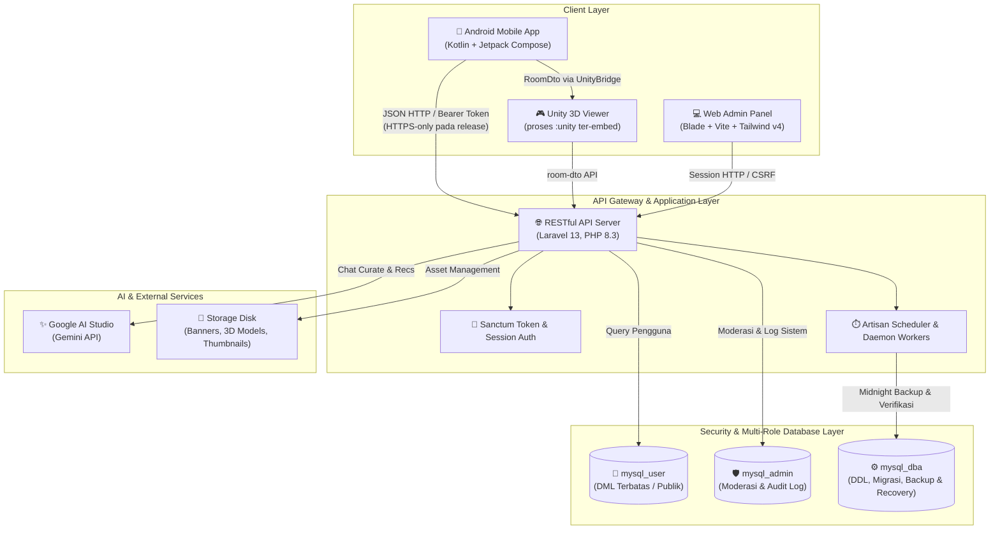

<div align="center">

# 🏛️ VEN — Value Exhibition Network

### *The Next-Generation Digital Art & 3D Value Gallery Ecosystem*

[](ven-mobile/)
[](backend-api/backend/)
[](backend-api/backend/)
[](backend-api/backend/)
[](ven-mobile/unityLibrary/)
[](ven-mobile/docs/DESIGN.md)
[](#-pengujian-otomatis-automated-testing)
[](#-pengujian-otomatis-automated-testing)

<p align="center">
  <b>VEN (Value Exhibition Network)</b> adalah ekosistem pameran seni dan galeri 3D digital interaktif yang menjembatani seniman, desainer, kurator, dan pengunjung dalam ruang pameran imersif. Memadukan aplikasi native <b>Android (Jetpack Compose)</b> dengan backend RESTful API berkinerja tinggi berbasis <b>Laravel 13</b>, arsitektur basis data <i>Least Privilege</i>, audit keamanan berlapis (backend & mobile), serta integrasi kecerdasan buatan <b>Google Gemini</b>.
</p>

---

</div>

## 📑 Daftar Isi

- [💡 Tentang VEN](#-tentang-ven)
- [🏛️ Arsitektur Sistem](#️-arsitektur-sistem)
- [✨ Fitur Utama](#-fitur-utama)
  - [1. Mobile Client (Android Native)](#1-mobile-client-android-native)
  - [2. Backend API & Admin Web Panel](#2-backend-api--admin-web-panel)
  - [3. Keamanan Berlapis: 7 Pilar Audit DB & Hardening Mobile](#3-keamanan-berlapis-7-pilar-audit-db--hardening-mobile)
- [📁 Struktur Repositori](#-struktur-repositori)
- [🚀 Panduan Memulai Cepat (Getting Started)](#-panduan-memulai-cepat-getting-started)
- [🧪 Pengujian Otomatis (Automated Testing)](#-pengujian-otomatis-automated-testing)
- [📊 Status Proyek & Dokumentasi](#-status-proyek--dokumentasi)
- [🛠️ Standar Pengembangan & Git Workflow](#️-standar-pengembangan--git-workflow)
- [📄 Lisensi & Hak Cipta](#-lisensi--hak-cipta)

---

## 💡 Tentang VEN

Platform **VEN** dirancang untuk mendemokratisasi akses karya seni, desain grafis, poster, dan model 3D melalui ruang galeri digital. Melalui platform ini:

| Peran | Kemampuan |
|:---:|---|
| 🎨 **Kreator** | Mempublikasikan karya poster 2D maupun merancang ruang pameran 3D (*Value Exhibit*) lengkap dengan penataan furnitur dan pencahayaan. |
| 👥 **Pengunjung** | Menjelajahi galeri pameran secara virtual, melihat detail karya, mengajukan jadwal pertemuan (*Request Meeting*), dan berkonsultasi dengan asisten kurator AI cerdas. |
| 🛡️ **Administrator & Kurator** | Mengelola dasbor terpusat untuk memoderasi karya, memverifikasi kepatuhan konten pameran, mengaudit log aktivitas sistem, dan menjatuhkan sanksi akun secara *real-time*. |

---

## 🏛️ Arsitektur Sistem

Ekosistem VEN dibangun dengan memisahkan domain aplikasi secara bersih:



---

## ✨ Fitur Utama

### 1. Mobile Client (Android Native)
Dibangun menggunakan **Kotlin** dan **Jetpack Compose** dengan pendekatan *Unidirectional Data Flow (UDF)* — setiap fitur terpisah rapi menjadi `Screen.kt` (stateless), `Route.kt` (stateful), `ViewModel.kt`, dan `UiState.kt`:

* 🚀 **Smart Feed & Refresh System (Instagram Style)**:
  * **Pull-to-Refresh**: Usap layar ke bawah dari bagian atas untuk memicu pembaruan data secara dinamis dengan animasi spinner Material 3.
  * **Double-Tap Tab Bar**: Ketuk tab *Beranda* atau *Explore* dua kali untuk scroll instan ke paling atas dan menyaring karya yang sudah pernah dilihat (`seenMediaIds`), memastikan selalu tersaji hal-hal baru dan segar.
  * **State Hoisting**: Posisi scroll daftar karya tersimpan aman antar perpindahan tab navigasi.
* 🖼️ **Feed Beranda Imersif**:
  * Carousel pameran *Coming Soon* dengan banner visual tajam.
  * Kartu karya (*PostCard*) elegan dengan rasio media dinamis, tombol navigasi jadwal langsung, dan pemanggil 3D exhibit viewer.
* 🔍 **Explore & Unified Discovery**:
  * Grid eksplorasi 3 kolom dengan *Memory LRU Cache* (0ms) dan *Disk Cache* ter-downsample (360x480).
  * Pencarian terpadu dengan *debounce* instan: tab *For You, Accounts, Posts,* dan *Exhibits*.
  * Filter modal kategori dinamis berbasis *Bottom Sheet*.
* 🏛️ **3D Exhibition Editor & Viewer**:
  * Pembuatan ruang pameran virtual interaktif: checklist persiapan, penamaan, pemilihan template ruang, penempatan objek/furnitur, dan kontrol palet warna.
  * Viewer pameran 3D berbasis **Unity** (proses `:unity` ter-embed) dengan penyambutan data ruangan *real-time* dari API (`room-dto`).
* 📅 **Jadwal Pertemuan (Schedule & Request Meeting — UC-17)**:
  * Pengajuan, peninjauan, dan konfirmasi jadwal temu kurator/seniman dalam 4 tab: *Approved, Waiting, Requests,* dan *History*.
  * Kalender pemilih tanggal dinamis + input jam/menit AM-PM, validasi jadwal lampau, dan catatan pertemuan.
* 🤖 **Asisten Cerdas AI (Gemini Assistant)**:
  * Panel drawer interaktif untuk tanya jawab seputar karya seni dan kurasi pameran, dengan riwayat chat persisten.
* 🌗 **Theme Engine (Dark & Light Mode) & Multi-Bahasa (EN/ID)**:
  * Palet desain kustom (`VexColors`) dengan design token lengkap — warna, spacing, radius, tipografi, dan motion — dioptimalkan untuk **Dark Mode** elegan yang menonjolkan estetika karya seni.
  * Seluruh antarmuka tersedia dalam dua bahasa (*English* & *Bahasa Indonesia*) dengan pemilihan bahasa di pengaturan.

---

### 2. Backend API & Admin Web Panel
Dibangun di atas fondasi **Laravel 13** dengan performa tinggi dan struktur modular:

* **High-Performance RESTful API**: Endpoint JSON terstruktur rapi (`{data, message}`) untuk seluruh alur bisnis aplikasi mobile — autentikasi & OTP, profil, pameran, karya, undangan, pencarian, dan AI.
* **Web Admin Panel Terintegrasi**: Dasbor moderasi karya, verifikasi pameran, manajemen pengguna, inspeksi riwayat aktivitas (*LogAudit*), dan penjatuhan sanksi akun berbasis **Blade Views** dan **Tailwind CSS v4**.
* **Proteksi Mutasi Data**: Validasi ketat Form Request, *Policy-based authorization*, dan pencegahan injeksi payload.
* **Penanganan Galat Terpusat**: Semua endpoint `/api/*` selalu merespons JSON tanpa membocorkan detail internal; akses langsung dari browser dialihkan ke halaman 404 kustom.
* **Integrasi AI Gemini**: Endpoint analitik kurasi dan rekomendasi konten otomatis dengan grounding konteks pameran & karya.

---

### 3. Keamanan Berlapis: 7 Pilar Audit DB & Hardening Mobile

#### 🗄️ Backend — 7 Pilar Kepatuhan Audit Keamanan Basis Data

Backend VEN telah diaudit secara formal dan memenuhi 7 standar ketat arsitektur basis data:

| No | Standar Audit | Implementasi Teknis pada VEN |
|:--:|---|---|
| **1** | **Pembatasan Akses dengan View** | Filter data sensitif (`kata_sandi`, `google_id`, `role`) menggunakan view basis data `v_pengguna_publik` untuk konsumsi endpoint publik. |
| **2** | **Hashing & Salting** | Proteksi seluruh kata sandi menggunakan algoritma **Bcrypt** (`$2y$`) dengan *salt* unik dinamis. |
| **3** | **Enkripsi AES-256-GCM & Blind Index** | Enkripsi simetris data sensitif pihak ketiga (`google_id`) via AES-256-GCM dengan *Blind Index* (HMAC-SHA-256) untuk pencarian terenkripsi berkecepatan tinggi. |
| **4** | **Database Transactions (ACID)** | Eksekusi transaksi atomik (`DB::transaction`) yang menjamin sifat *Commit* pada alur sukses dan *Rollback* menyeluruh saat terjadi kendala. |
| **5** | **Concurrent Access & Locking** | Proteksi *race condition* saat moderasi sanksi akun dan klaim pameran dengan *Pessimistic Row Locking* (`lockForUpdate`). |
| **6** | **Backup Otomatis & Terjadwal** | Pencadangan basis data berkala setiap tengah malam (00:00) dengan retensi rotasi 30 hari serta perintah manual DBA `ven:backup-db`. |
| **7** | **Disaster Recovery Sandbox Verification** | Otomasi verifikasi pemulihan cadangan database ke sandbox terisolasi via perintah `ven:restore-db`. |

> 📖 *Dokumentasi teknis lengkap masing-masing kepatuhan dapat ditinjau di direktori [`backend-api/backend/docs/`](backend-api/backend/docs/).*

#### 📱 Mobile Client — Hardening Keamanan Aplikasi

| Lapisan | Implementasi pada `ven-mobile` |
|---|---|
| **Penyimpanan Sesi** | Token & data pengguna terenkripsi **AES-256-GCM** via **AndroidKeyStore** (`util/SecurePrefs`) dengan migrasi transparan dari data lama — kecil kemungkinan dibaca dari root/backup. |
| **Transport** | Build release **HTTPS-only** (`networkSecurityConfig`); cleartext hanya diizinkan untuk emulator/localhost pada build debug. |
| **Backup** | Preferensi sesi sensitif dikecualikan dari *cloud backup* & *device transfer* (`backup_rules` / `data_extraction_rules`). |
| **Logging** | Interceptor HTTP level `BODY` hanya aktif pada build debug — kata sandi, OTP, dan JWT tidak pernah tercetak di logcat release. |
| **Komponen** | Activity Unity tidak `exported` (tidak dapat dipanggil aplikasi lain); `proguard-rules.pro` disiapkan untuk obfuskasi release. |

---

## 📁 Struktur Repositori

```text
ven/
├── .agents/                   # Panduan AI rules, best practices, dan workflow skills
│   ├── rules/                 # Aturan koding bersih, arsitektur, dan kebijakan git
│   └── skills/                # Standar spesialisasi Laravel, Android Compose, dan TDD
├── backend-api/
│   └── backend/               # Core Laravel Backend & Admin Web Panel
│       ├── app/
│       │   ├── Http/Controllers/ # Controller API dan Controller Web Admin
│       │   ├── Models/           # Eloquent Models (Karya, Pameran, Pengguna, Objek, dsb.)
│       │   ├── Services/         # Layer Logika Bisnis & Layanan Gemini AI
│       │   └── Observers/        # Observer Aktivitas & Audit Database
│       ├── config/               # Konfigurasi database multi-role, backup, & AI
│       ├── database/             # Migrasi skema database, Seeder data, & Views
│       ├── docs/                 # Dokumentasi formal 7 pilar audit keamanan database
│       ├── resources/views/      # Template Blade untuk Admin Web Panel (Tailwind CSS v4)
│       └── tests/                # Automated PHPUnit Test Suites
├── ven-mobile/                # Aplikasi Klien Android Native
│   ├── app/src/main/
│   │   ├── java/com/ven/app/
│   │   │   ├── core/             # Konfigurasi global (AppConfig) & lokalisasi (AppStrings)
│   │   │   ├── data/             # API Service, SessionManager terenkripsi, & Data Models
│   │   │   ├── ui/
│   │   │   │   ├── components/   # Komponen UI bersama (VexButton, VexTextArea, PostCard, ...)
│   │   │   │   ├── navigation/   # Routing AppNavigation & BottomNav Bar
│   │   │   │   ├── screens/      # Feature Screens (Home, Explore, Schedule, AI, Create, ...)
│   │   │   │   └── theme/        # Token desain resmi VEN (Color, Space, Radius, Typography)
│   │   │   └── util/             # Utility (SecurePrefs, DateFormatter, GoogleAuth, ...)
│   │   └── res/                  # Vector drawables, strings lokalisasi, & resource visual
│   ├── unityLibrary/             # Modul Unity 3D Viewer (il2cpp)
│   └── docs/DESIGN.md            # Spesifikasi desain visual & alur interaksi Figma
├── docs/                      # STATUS-PROYEK-VEN.md — status modul, verifikasi, & kendala
└── postman/                   # Koleksi pengujian endpoint API & suite verifikasi audit
```

---

## 🚀 Panduan Memulai Cepat (Getting Started)

### Prasyarat Sistem

| Komponen | Kebutuhan |
|---|---|
| 🖥️ **Backend** | PHP >= 8.3, Composer >= 2.6, MySQL >= 8.0/8.4 (Laragon sangat disarankan di Windows), Node.js >= 18 |
| 📱 **Mobile** | Android Studio (Ladybug / Meerkat / terbaru), JDK 17, Android SDK Platform 34/35 |

---

### Langkah Setup Backend & Database

1. **Masuk ke folder backend**:
   ```bash
   cd backend-api/backend
   ```

2. **Pasang dependensi PHP & Node.js**:
   ```bash
   composer install
   npm install
   ```

3. **Konfigurasi Environment**:
   ```bash
   cp .env.example .env
   php artisan key:generate
   ```
   *Pastikan kredensial database pada `.env` telah disesuaikan dengan konfigurasi MySQL lokal Anda.*

4. **Inisialisasi Database Multi-Role (Least Privilege)**:
   ```bash
   php artisan ven:setup-db
   ```

5. **Jalankan Migrasi Skema & Seeder**:
   ```bash
   php artisan migrate --database=mysql_dba
   php artisan db:seed
   ```

6. **Jalankan Development Server**:
   ```bash
   # Menjalankan server API dan kompilasi asset frontend secara simultan
   npm run dev
   # Di terminal terpisah:
   php artisan serve
   ```
   *RESTful API server akan aktif di `http://127.0.0.1:8000` dan Admin Web Panel dapat diakses di `http://127.0.0.1:8000/admin`.*

---

### Langkah Menjalankan Mobile App

1. **Konfigurasi endpoint API**: salin/atur file `ven-mobile/.env`:
   ```env
   # Emulator Android memakai host loopback bawaan
   BASE_URL=http://10.0.2.2:8000/api/
   # Google Web Client ID untuk Sign-In
   GOOGLE_SERVER_CLIENT_ID=<client-id-anda>
   ```
   > 💡 *Untuk perangkat fisik, ganti `10.0.2.2` dengan IP LAN komputer Anda. Build release wajib memakai `https://` — aplikasi menolak base URL non-HTTPS pada mode release.*
2. Buka folder [`ven-mobile/`](ven-mobile/) di **Android Studio**.
3. Biarkan Gradle melakukan sinkronisasi dependensi proyek (*Gradle Sync*).
4. Pastikan backend API berjalan.
5. Pilih target perangkat (Emulator atau Perangkat Fisik via USB Debugging).
6. Klik **Run 'app'** (`Shift + F10`) atau jalankan perintah kompilasi:
   ```powershell
   cd ven-mobile
   .\gradlew.bat installDebug
   ```

---

## 🧪 Pengujian Otomatis (Automated Testing)

Integritas sistem VEN diuji secara berkala untuk memastikan reliabilitas tinggi — hasil verifikasi terakhir: **19 November 2026**.

### 1. Backend API & Keamanan Database (PHPUnit)
```powershell
cd backend-api/backend
php artisan test
```
> ✅ **Status: 87 test — 87 lulus, 406 assertion (100% lulus, 0 galat).**

> ⚠️ Pengujian wajib menggunakan database `ven_testing`; dilarang mengarahkan test ke database aplikasi `ven`.

### 2. Android Mobile Client (Gradle Unit Test)
```powershell
cd ven-mobile
.\gradlew.bat testDebugUnitTest
```
> ✅ **Status: 70 test — 70 lulus (100% lulus, 0 galat)** — mencakup ViewModel, UiState, navigasi, & logika utilitas.

### 3. Build & Smoke Test
```powershell
cd ven-mobile
.\gradlew.bat assembleDebug
```
> ✅ **Status: BUILD SUCCESSFUL** — APK debug (~124,9 MB) tersedia di `app/build/outputs/apk/debug/`.

### 4. Postman API Suite
Koleksi lengkap pengujian endpoint API dan verifikasi 7 pilar kepatuhan database tersedia di folder [`postman/`](postman/) siap diimpor ke Postman.

---

## 📊 Status Proyek & Dokumentasi

| Dokumen | Isi |
|---|---|
| 📋 [`docs/STATUS-PROYEK-VEN.md`](docs/STATUS-PROYEK-VEN.md) | Status modul per fitur (✅/⚠️/❌), hasil verifikasi terkini (test, build, tanggal, commit), daftar bagian mock, dan kendala aktif beserta rekomendasinya. |
| 🎨 [`ven-mobile/docs/DESIGN.md`](ven-mobile/docs/DESIGN.md) | Spesifikasi design system Vex: palet warna, tipografi, spacing, komponen, dan pola interaksi. |
| 🗄️ [`backend-api/backend/docs/`](backend-api/backend/docs/) | Dokumentasi formal 7 pilar audit keamanan basis data. |
| 🧪 [`postman/`](postman/) | Koleksi Postman pengujian API & audit keamanan. |

---

## 🛠️ Standar Pengembangan & Git Workflow

1. **Clean Code & Architecture**: Seluruh kontribusi wajib mengikuti kaidah *Skinny Controller, Business Logic in Services, Unidirectional Data Flow (Compose)*, dan dokumentasi fungsi yang rapi — lihat [`.agents/rules/`](.agents/rules/).
2. **Status Proyek Selalu Sinkron**: Setiap penambahan/perubahan/penghapusan fitur **wajib** memperbarui [`docs/STATUS-PROYEK-VEN.md`](docs/STATUS-PROYEK-VEN.md) pada commit yang sama.
3. **Kebijakan Git Push**:
   * **AI Agent dilarang menjalankan `git push` otomatis**.
   * Seluruh eksekusi `git push` ke remote repository adalah **hak prerogatif eksklusif dari Developer (Pengguna)** secara manual.

---

## 📄 Lisensi & Hak Cipta

Hak Cipta © 2026 Tim Pengembang **VEN (Value Exhibition Network)**.  
Seluruh hak cipta dilindungi undang-undang.

<div align="center">
  <sub>Dibangun dengan 💜 oleh Tim VEN</sub>
</div>
